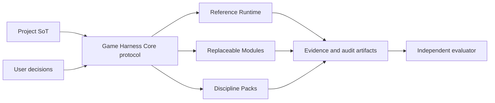

# Game Harness Set

[](https://github.com/piecebypiece/game-harness/actions/workflows/ci.yml)
[](LICENSE)

**상태: Development Preview · protocol/runtime `0.2.0`**

게임 개발 AI가 더 많은 일을 하게 만들기 전에, **무엇을 요구했고 무엇을 실제로 검증했으며 어떤 결정에 사용자가 동의했는지**를 남기는 엔진 중립 control/evidence sidecar입니다. 프로젝트의 정본이나 기존 개발 도구를 대체하지 않습니다.

현재 공개물은 M1 Protocol Integrity & Security의 Reference Runtime입니다. 통합 게임개발 제품이나 Public Alpha를 주장하지 않으며, 실제 Unity 런타임과 네 분야 end-to-end 실증은 아직 남아 있습니다.

## 왜 만들었나

이 저장소는 장기간의 게임개발 에이전트 운용 대화와 실제 프로젝트 조사에서 반복된 문제를 제품 계약으로 바꾼 결과입니다. 대화 원문이나 개인 프로젝트 정보는 포함하지 않고 다음 의도만 재구성했습니다.

- AI가 코드를 생성하는 능력보다 **완료를 거짓으로 주장하지 않는 능력**이 먼저 필요했습니다.
- 게임기획, 개발, 아트, 마케팅·사업은 서로 다른 증거와 도구를 쓰므로 하나의 거대한 고정 파이프라인에 넣지 않습니다.
- 코드 평가, 설계, 테스트, 사용자 합의, 사용자 학습, 인지 병목 지원을 교체 가능한 Module/Pack으로 조합해야 합니다.
- 사용자의 결정권과 프로젝트 정본은 하네스 밖에 남기고, 하네스는 상태·근거·결정 연결만 담당해야 합니다.
- 긴 세션과 다중 에이전트에서 생기는 context rot를 채팅 기억이 아니라 versioned artifact로 줄여야 합니다.
- 더 좋은 AI가 등장할수록 하네스의 프롬프트와 choreography는 줄어들 수 있어야 하며, protocol과 evidence는 살아남아야 합니다.

설계 배경과 배운 점은 [설계 기원](docs/design-origin.md)에 정리했습니다.

## 내가 어떻게 쓰려는가

개인 게임 프로젝트에 처음부터 자동 수정 권한을 주는 방식이 아니라 다음 순서로 도입합니다.

1. 기존 저장소 옆에 read-only sidecar로 붙여 SoT, git 상태, 엔진 표면과 현재 근거를 탐지합니다.
2. 작업마다 `RequirementSet`으로 요구 분모를 고정하고 `ClaimInventory`로 누락된 주장을 확인합니다.
3. 코드·문서·빌드·테스트·에디터·런타임·사람 확인을 서로 다른 evidence axis로 기록합니다.
4. 비용, 외부 게시, 프로젝트 수정처럼 부작용이 있는 행동은 exact `ExecutionIntent`와 `DecisionRecord`를 연결합니다.
5. 구현자와 평가자의 관계를 `EvaluationAssignment`에 고정하고, 평가가 없으면 `NOT_RUN`으로 남깁니다.
6. 같은 실패가 반복되면 Improvement Proposal을 만들되 프로젝트 규칙을 자동으로 덮어쓰지 않습니다.
7. 개발 실증 후 게임기획, 아트, 마케팅·사업 Pack을 각각 독립적으로 추가합니다.

이 방식으로 새 프로젝트 설치 UX, 기존 프로젝트의 안전한 도입, 사용자별 도구 교체와 향후 AI 발전에 따른 축소 가능성을 함께 검증하려 합니다.

## 구조



- `@game-harness/protocol`: JSON Schema, TypeScript type, validation, completeness, decision binding, redaction. 런타임 의존성 0개.
- `@game-harness/core`: 탐지·상태·evidence·개선 제안·평가 패킷을 제공하는 선택적 Reference Runtime.
- Engine Profile: Unity, Unreal, Godot 같은 엔진별 어댑터 경계. 현재 fixture 기반 예제 profile 하나만 포함합니다.
- Module/Discipline Pack: 설계된 확장 경계이며 자동 설치·broker enforcement는 이후 마일스톤입니다.

세부 경계는 [아키텍처](docs/architecture.md)를 참고하세요.

## 설치

Node.js 20 이상이 필요합니다. 현재 npm registry에는 게시하지 않았습니다.

```bash
npm install github:piecebypiece/game-harness
```

소스에서 실행하려면:

```bash
git clone https://github.com/piecebypiece/game-harness.git
cd game-harness
npm ci
npm test
```

## 5분 사용 예시

설치한 프로젝트에서 현재 상태를 읽습니다. `detect`는 `--out`을 주지 않으면 파일을 쓰지 않습니다.

```bash
npx game-harness detect --project .
npx game-harness status --project .
```

검증 근거를 프로젝트의 `.game-harness/evidence/`에 명시적으로 기록합니다.

```bash
npx game-harness evidence add \
  --project . \
  --kind test \
  --status PASS \
  --summary "focused tests completed"
```

평가자용 고정 패킷을 내보냅니다.

```bash
npx game-harness export evaluator-packet \
  --project . \
  --out artifacts/evaluator-packet.json
```

평가 할당과 결과가 제공되지 않은 패킷은 `evaluation_gate.status: "NOT_RUN"`입니다. 패킷 생성 자체는 평가 통과가 아닙니다.

## Protocol API

```ts
import {
  SCHEMAS,
  validateArtifact,
  validateClaimCompleteness,
  verifyEvaluationIntegrity
} from "@game-harness/core";

const result = validateArtifact("requirementSet", candidate);
if (!result.valid) console.error(result.issues);

console.log(SCHEMAS.executionIntent);
```

Protocol만 필요한 구현은 저장소의 `packages/protocol`을 독립적으로 사용할 수 있습니다. Protocol v1 전까지 schema 호환성은 보장하지 않습니다.

## 현재 검증 범위

- protocol/runtime TypeScript typecheck
- 전체 JSON Schema의 최소·알 수 없는 필드 검증
- RequirementSet 분모와 ClaimInventory completeness
- exact ExecutionIntent와 DecisionRecord binding
- evaluator assignment/result hash 및 독립성 무결성
- stale/oversized context의 fail-closed 처리
- credential·로컬 절대 경로 redaction
- core CLI 회귀 테스트
- 실제 tarball을 임시 소비자 프로젝트에 설치하는 smoke test
- 공개 tarball 포함 파일과 생성 artifact 누출 검사

## 안전 경계

- 기본 명령은 프로젝트 정본, 엔진 설정, source asset을 수정하지 않습니다.
- evidence 기록처럼 쓰기가 필요한 명령은 사용자가 명시적으로 호출해야 합니다.
- credential과 개인 로컬 경로는 공개 artifact에 남기지 않는 것을 계약으로 둡니다.
- 현재 `MutationLease`는 schema/semantics만 있습니다. OS 수준 write broker와 fencing enforcement는 구현 전입니다.
- 실제 프로젝트 적용은 dirty baseline을 보존하고 read-only shadow 단계부터 시작해야 합니다.

위협 모델과 공개 제보 절차는 [보안 모델](docs/security-model.md)과 [SECURITY.md](SECURITY.md)를 참고하세요.

## 모듈화 방향

| 축 | Core가 보존하는 계약 | 교체 가능한 구현 예시 |
|---|---|---|
| 코드 평가 | claim/evidence/evaluator integrity | Codex, Claude Code, 정적 분석기 |
| 설계 | requirement/context/decision | 문서 스킬, CodeWiki, ADR 도구 |
| 테스트 | evidence axis와 artifact hash | GameCI, 엔진 CLI, 로컬 runner |
| 사용자 합의 | intent/decision binding | CLI, GitHub, 별도 승인 UI |
| 사용자 학습 | opt-in learning evidence | 퀴즈, 회상, 새 사례 검증 |
| 인지 병목 | context budget와 handoff artifact | 요약기, 검색기, 시각화 도구 |

## 로드맵과 한계

- M1: protocol integrity/security — 현재 개발 미리보기
- M2: install/uninstall, mutation broker, module registry
- M3: 두 독립 게임 프로젝트의 development vertical slice와 live runtime
- M4+: 게임기획·개발·아트·마케팅/사업 Pack의 실제 표본 검증
- Public Alpha: fresh install, 독립 사용자, rollback, 지원 문서 기준을 모두 충족한 뒤 별도 판정

현재 제한은 [Known Limitations](docs/known-limitations.md), 지원 환경은 [Support Matrix](docs/support-matrix.md)에 명시합니다.

## 기여

[CONTRIBUTING.md](CONTRIBUTING.md)의 작은 contract-first 변경 원칙을 따라 주세요. 보안 문제는 공개 issue 대신 [SECURITY.md](SECURITY.md)의 비공개 경로를 사용합니다.

## English summary

Game Harness Set is a protocol-first control and evidence sidecar for AI-assisted game development. This repository contains a Development Preview of the engine-neutral protocol and a TypeScript Reference Runtime. It records requirements, evidence, decisions, and evaluator independence without owning project truth. It is not yet a production-ready integrated game-development harness.

MIT License.
